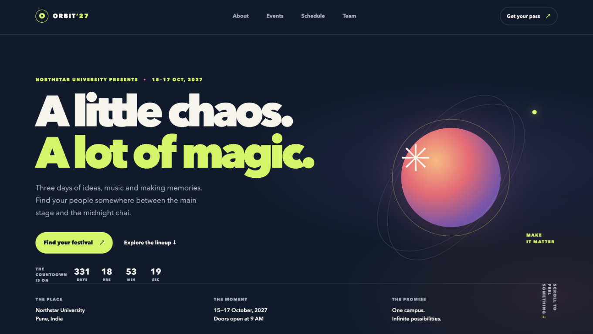

# Orbit 2027 — Campus Festival

A responsive landing page for a fictional college festival, built with plain HTML, CSS and JavaScript.

## Live website

**[Visit Orbit 2027](https://collegefest-five.vercel.app/)**

## Run locally

Open `index.html` in a browser, or serve this folder with any static file server. No build step, dependencies or API keys are required.

## Project files

- `index.html` — page structure and festival content
- `styles.css` — visual design and responsive layouts
- `app.js` — live festival countdown and registration demo

## Features

- Festival hero with event dates, animated CSS artwork and live countdown
- Six event cards and a three-day schedule with times and venues
- Organizer and partner sections
- Labeled registration form with browser validation and an on-page demo confirmation
- Responsive layouts, keyboard focus styles, skip link and reduced-motion support

The registration form is front-end only. It does not send or save personal information. Orbit and Northstar University are fictional.

## Deploy

The live site is hosted on Vercel at <https://collegefest-five.vercel.app/>.
